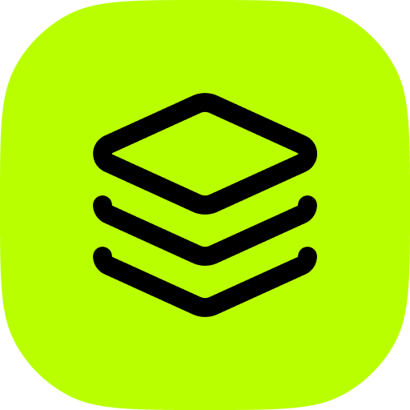
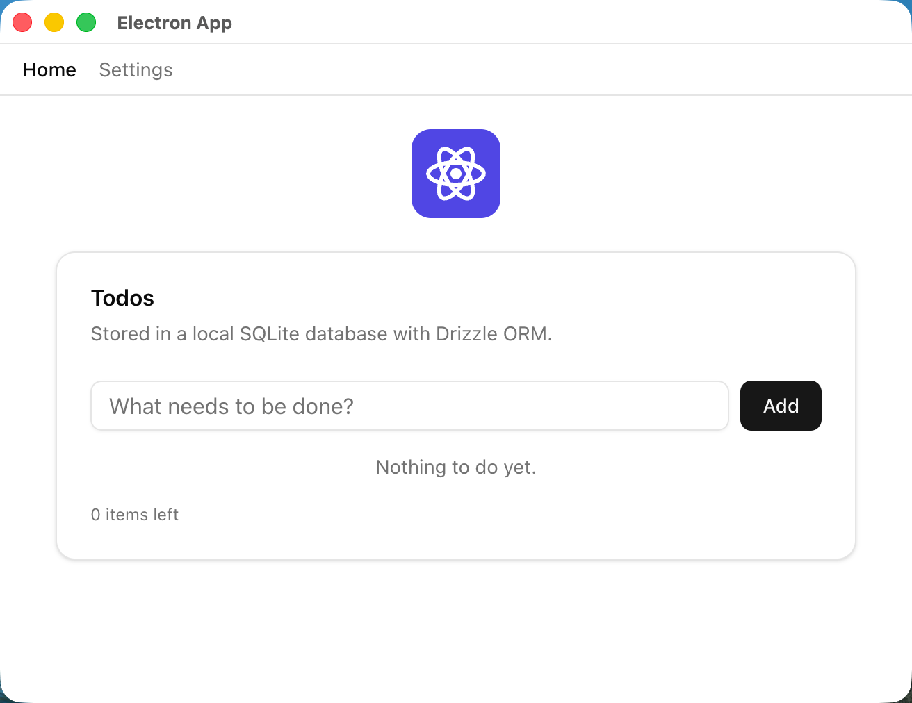
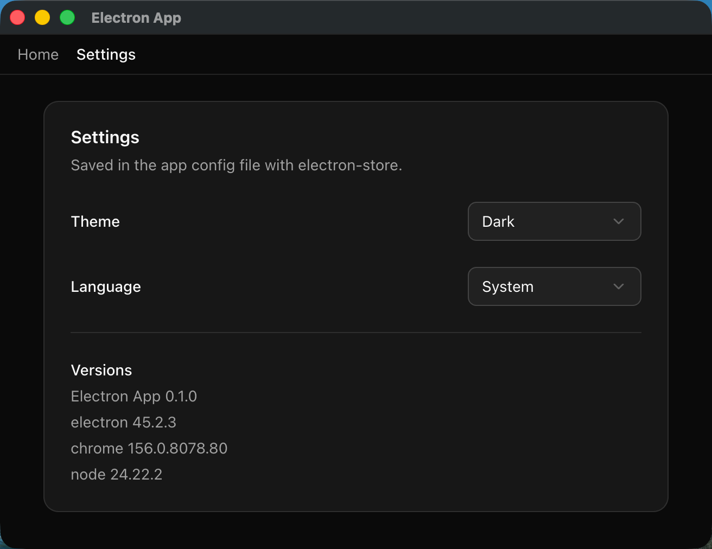
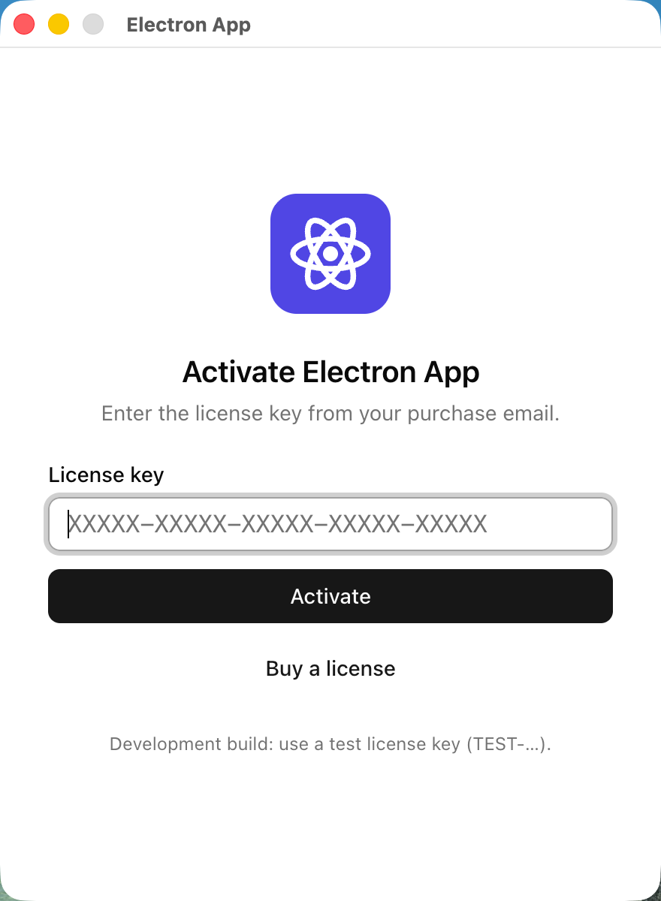

# Electron AppStack

A complete Electron + TypeScript starter (React, tRPC, SQLite, auto update, signed releases…), and its documentation.

**Documentation: [electron-appstack.com](https://electron-appstack.com)**

## Screenshots

The app you get after `npm run dev`: a todo list stored in SQLite and a settings page with light and dark themes. The license activation window appears once you turn licensing on.

<p>
  
  
</p>
<p>
  
</p>

## Stack

**Desktop**

- [Electron](https://www.electronjs.org): cross-platform desktop runtime
- [electron-vite](https://electron-vite.org): build tool and dev server
- [Node.js](https://nodejs.org): main process runtime
- [V8 bytecode](https://v8.dev): compiled main process

**Frontend**

- [React](https://react.dev): UI library, version 19
- [TypeScript](https://www.typescriptlang.org): strict types everywhere
- [Vite](https://vite.dev): instant hot reload
- [TanStack Router](https://tanstack.com/router): type-safe file-based routing
- [TanStack Query](https://tanstack.com/query): data fetching and caching
- [Tailwind CSS](https://tailwindcss.com): utility-first styling, v4
- [shadcn/ui](https://ui.shadcn.com): accessible components
- [Radix UI](https://www.radix-ui.com): headless primitives
- [Lucide](https://lucide.dev): icon set
- [i18next](https://www.i18next.com): typed translations

**Backend and data**

- [tRPC](https://trpc.io): end-to-end typed IPC
- [Zod](https://zod.dev): runtime validation
- [SQLite](https://sqlite.org): embedded local database
- [Drizzle ORM](https://orm.drizzle.team): typed queries and migrations
- [electron-store](https://github.com/sindresorhus/electron-store): typed app config

**Shipping and selling**

- [electron-builder](https://www.electron.build): installers for every platform
- [electron-updater](https://www.electron.build/auto-update): automatic updates
- [GitHub Actions](https://github.com/features/actions): build, sign and publish
- [Changesets](https://github.com/changesets/changesets): versions and changelog
- [LicenseManager.dev](https://licensemanager.dev): license keys and activation
- [Stripe](https://stripe.com): payments

**Tooling**

- [Biome](https://biomejs.dev): linting and formatting
- [Vitest](https://vitest.dev): unit tests
- [Claude Code](https://claude.com/claude-code): AGENTS.md and skills included

## Create an app

Copy the template with [degit](https://github.com/Rich-Harris/degit):

```sh
npx degit nick-keller/electron-appstack/template my-app
cd my-app
npm install
npm run dev
```

## What's in this repository

This is a [pnpm](https://pnpm.io/) monorepo with two packages:

| Folder                   | Description                                                                                   |
| ------------------------ | --------------------------------------------------------------------------------------------- |
| [`template/`](template)  | The Electron app template. This is what users clone with degit. |
| [`docs/`](docs)          | The documentation website, built with [Next.js](https://nextjs.org/) and [Nextra](https://nextra.site/), deployed at [electron-appstack.com](https://electron-appstack.com). |

The template is self-contained: it must not depend on anything outside `template/`, since degit only copies that folder. Its `README.md`, `AGENTS.md` and `.github/workflows` are written for people who cloned it.

The template is installed with pnpm in this monorepo, but users install it with npm, so it ships its own `package-lock.json`. After changing `template/package.json`, run `pnpm lock:template` to update it (CI fails otherwise).

## Development

Requires Node.js 22.12+ and pnpm.

```sh
pnpm install
```

| Command              | Description                                     |
| -------------------- | ----------------------------------------------- |
| `pnpm dev:template`  | Run the Electron template in development mode   |
| `pnpm dev:docs`      | Run the documentation website on localhost:3000 |
| `pnpm build`         | Build both packages                             |
| `pnpm typecheck`     | Type check both packages                        |
| `pnpm test`          | Run the template unit tests                     |
| `pnpm check`         | Lint and check formatting with Biome            |
| `pnpm check:fix`     | Fix lint and formatting issues                  |
| `pnpm lock:template` | Regenerate `template/package-lock.json`         |
| `pnpm update:boilerplates` | Refresh GitHub stats and Electron versions in `docs/data/boilerplates.json` |

The landing page is `docs/app/(home)/page.tsx`. Documentation pages live in `docs/content/` as MDX files, served under `/doc`. The sidebar order is set in `docs/content/_meta.ts`. Each page sets its search title and meta description in its frontmatter (`title`, `description`, keep them unique and around 60 and 150 characters); the sidebar label comes from `_meta.ts`. `sitemap.xml`, `robots.txt` and `llms.txt` are generated from `docs/app/sitemap.ts`, `docs/app/robots.ts` and `docs/app/llms.txt/route.ts`. Shared JSON-LD entities (author, organization) are in `docs/app/structured-data.tsx`.

The comparison page (`/compare`) and the ranking page (`/best-electron-boilerplate`) are generated from `docs/data/boilerplates.json`: features and stack are curated by hand, stars, last commits and Electron versions are refreshed with `pnpm update:boilerplates`. Scores and rankings are computed in `docs/lib/boilerplates.ts`.

## License

Electron AppStack is open source under the [MIT License](LICENSE.md). Contributions are welcome: open an issue or a pull request.

The license is also published at [electron-appstack.com/doc/license](https://electron-appstack.com/doc/license), from `docs/content/license.mdx`: keep it in sync with `LICENSE.md` and `template/LICENSE.md`.
