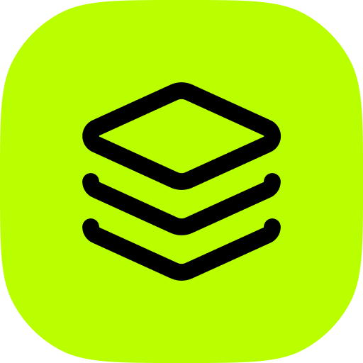

# Electron AppStack

A complete Electron + TypeScript starter (React, tRPC, SQLite, auto update, signed releases…), and its documentation.

**Documentation: [electron-appstack.com](https://electron-appstack.com)**

## Create an app

Copy the template with [degit](https://github.com/Rich-Harris/degit):

```sh
npx degit nick-keller/electron-appstack/template my-app
cd my-app
npm install
npm run dev
```

## What's in this repository

This is a [pnpm](https://pnpm.io/) monorepo with two packages:

| Folder                   | Description                                                                                   |
| ------------------------ | --------------------------------------------------------------------------------------------- |
| [`template/`](template)  | The Electron app template. This is what users clone with degit. |
| [`docs/`](docs)          | The documentation website, built with [Next.js](https://nextjs.org/) and [Nextra](https://nextra.site/), deployed at [electron-appstack.com](https://electron-appstack.com). |

The template is self-contained: it must not depend on anything outside `template/`, since degit only copies that folder. Its `README.md`, `AGENTS.md` and `.github/workflows` are written for people who cloned it.

The template is installed with pnpm in this monorepo, but users install it with npm, so it ships its own `package-lock.json`. After changing `template/package.json`, run `pnpm lock:template` to update it (CI fails otherwise).

## Development

Requires Node.js 22.12+ and pnpm.

```sh
pnpm install
```

| Command              | Description                                     |
| -------------------- | ----------------------------------------------- |
| `pnpm dev:template`  | Run the Electron template in development mode   |
| `pnpm dev:docs`      | Run the documentation website on localhost:3000 |
| `pnpm build`         | Build both packages                             |
| `pnpm typecheck`     | Type check both packages                        |
| `pnpm check`         | Lint and check formatting with Biome            |
| `pnpm check:fix`     | Fix lint and formatting issues                  |
| `pnpm lock:template` | Regenerate `template/package-lock.json`         |
| `pnpm update:boilerplates` | Refresh GitHub stats and Electron versions in `docs/data/boilerplates.json` |

The landing page is `docs/app/(home)/page.tsx`. Documentation pages live in `docs/content/` as MDX files, served under `/doc`. The sidebar order is set in `docs/content/_meta.ts`.

The comparison page (`/compare`) and the ranking page (`/best-electron-boilerplate`) are generated from `docs/data/boilerplates.json`: features and stack are curated by hand, stars, last commits and Electron versions are refreshed with `pnpm update:boilerplates`. Scores and rankings are computed in `docs/lib/boilerplates.ts`.

## License

Electron AppStack is free, source-available software under the [Electron AppStack License](LICENSE.md). You can use and modify it to build commercial apps and sell them, but not sell the boilerplate itself or publish it as a competing starter kit.

The license is also published at [electron-appstack.com/doc/license](https://electron-appstack.com/doc/license), from `docs/content/license.mdx`: keep it in sync with `LICENSE.md`.
